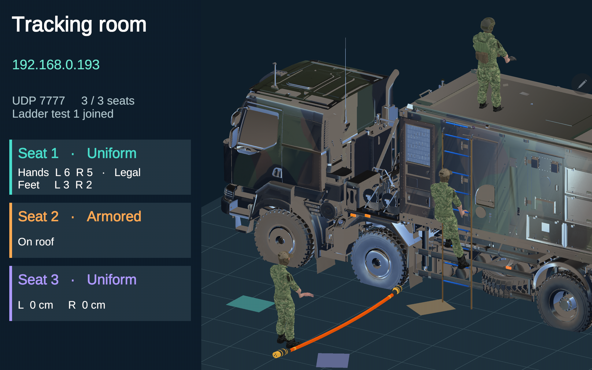
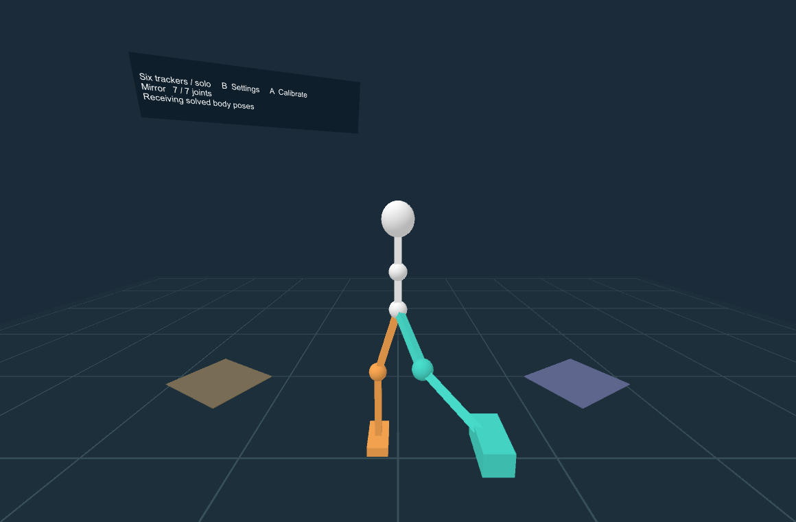
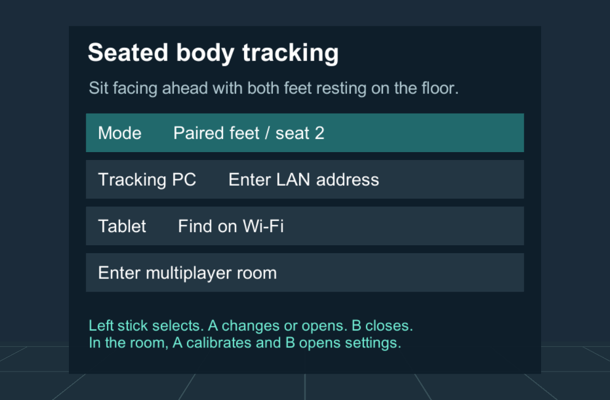
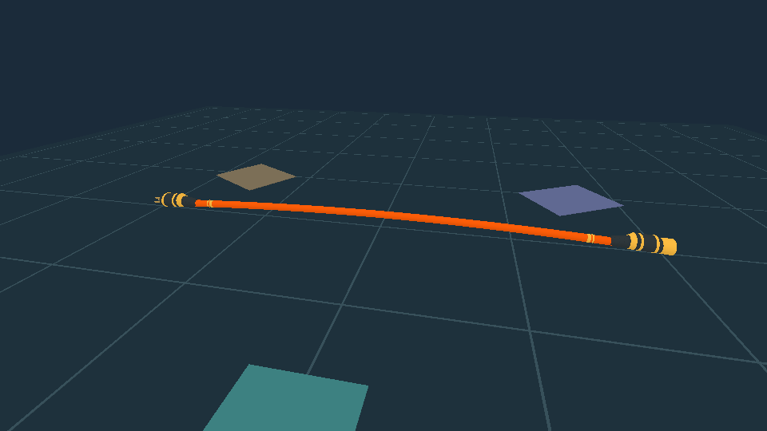
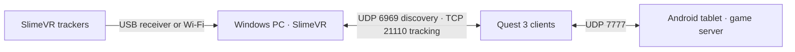

# VR Body Tracking for Quest 3

  [][slimevr]

Give **three seated Quest 3 players** one tracker per shoe. They can walk with the joystick, step over a floor cable, and climb a nine-rung ladder onto a vehicle roof. The tablet hosts the room and shows each player's hands and feet. The same Quest app can use **six trackers on one person** for a full-body mirror. Unity developers can import the tracking package separately.

**[Multiplayer smoke test](#multiplayer-smoke-test) · [Step over the cable](#step-over-the-cable) · [Climb onto the vehicle](#climb-onto-the-vehicle) · [Run the demo](#run-the-demo) · [Import into Unity](#import-into-unity) · [Build from source](#build-from-source) · [Troubleshooting](#troubleshooting)**



*Three simulated Quest clients connected to a physical Galaxy Tab S9+. Seat 1 is holding rungs 6 and 5, with its boots on 3 and 2. Seat 2 has reached the roof.*

---

## Run the demo

| Device | v0.1.4 build output | What to run |
| --- | --- | --- |
| Windows x64 PC | `Builds/SlimeVR/VRBodyTracking-Windows-x64.zip` | Extract the ZIP. Run `Start-Paired.cmd` for multiplayer or `Start-Stock-Solo.cmd` for the stock solver. |
| Each Quest 3 | `Builds/BodyTracking-Quest.apk` | Open **Body Tracking Quest** under **Unknown Sources**. |
| Android tablet | `Builds/BodyTracking-Tablet.apk` | Open **Body Tracking Tablet** to host the room. |

Use a matching Quest and tablet build. To produce these files from the tag, follow the [build instructions](#build-from-source). Earlier **v0.1.0** binaries are archived on [GitHub Releases][release].

Put the PC, headsets and tablet on the same LAN. Plug a USB tracker receiver into the PC. Wi-Fi trackers join the LAN directly. The Quest discovers the paired SlimeVR server automatically. Close the running SlimeVR GUI and server before switching launchers.

<details>
<summary><strong>Install the apps over USB</strong></summary>

Enable developer mode and USB debugging on each device, then accept its USB debugging prompt. From the Unity project root, use Android Platform Tools and replace each serial with the one printed by `adb devices`.

```shell
adb devices
adb -s QUEST_SERIAL install -r Builds/BodyTracking-Quest.apk
adb -s TABLET_SERIAL install -r Builds/BodyTracking-Tablet.apk
```

</details>

### One player with six trackers

1. Run **`Start-Stock-Solo.cmd`** for the stock solver. For automatic PC discovery with six Wi-Fi trackers already connected, use **`Start-Paired.cmd`** from the same Windows build. It includes the solo solver. Assign the sensors to the **chest, hip, left and right thighs, and left and right lower legs**. [SlimeVR mounting guide][mounting]
2. In the Quest app, select **Six trackers / solo** and **Start solo test**. The HUD shows the SlimeVR address once connected. If discovery keeps searching, enter the PC's LAN IPv4 address under **Tracking PC**. The Quest supplies the head pose to SlimeVR.
3. Complete the body measurements and mounting calibration in SlimeVR. With your shoes on the floor, face forward and press **X** in the room to reset yaw and set the first-person foot reference. Raise one knee and watch the knee and foot on that side move in the mirror. **A** switches your first-person avatar between standing and sitting. The mirror shows the six-tracker solve.



*The solo mirror in Unity, driven by the stock Windows server and six simulated sensors. The counter shows how many of the seven solved joints the headset is receiving.*

<a id="three-seated-players-with-two-trackers-each"></a>

### Multiplayer smoke test

Two Quests, one tablet and one tracker pair are enough to verify that both players see one another and that one player's feet respond. Add two more tracker pairs to track all three players.

1. **Start the tablet.** Put all devices on the same LAN. Install `BodyTracking-Quest.apk` on each Quest and `BodyTracking-Tablet.apk` on the tablet. Open **Body Tracking Tablet** and note its IP.
2. **Start SlimeVR on Windows.** Run `Start-Paired.cmd`. If your USB receiver and six named shoes already appear in the paired server, leave it running.
3. **Join different seats.** Open **Unknown Sources → Body Tracking Quest**. Press **B** if already in the room. Choose **Paired feet / seat 1** on one Quest and **seat 2** on the other. Leave **Tracking PC** and **Tablet** on **Find on Wi-Fi**. An upgraded headset tries its previous PC address and searches again if the address has changed.
4. **Check the soldiers.** Under **Soldier**, choose **Uniform** on one Quest and **Armored** on the other. Select **Enter multiplayer room** on both. With demo APKs **0.1.6** or later, rest one forearm on your thigh and bend your hand up and down. The bend should sit at the base of the palm, where the glove meets the forearm on the armored soldier. Then reach forward and watch the elbow extend. Repeat with the other hand. The other Quest and the tablet should show the same movement.
5. **Connect the shoes.** For a USB receiver kit, plug the paired receiver into the PC, power on the trackers and check that each appears online in SlimeVR. For Wi-Fi trackers, use SlimeVR's **Connect Trackers** wizard with your 2.4 GHz Wi-Fi details and a USB data cable. Strap one sensor to each shoe and set its exact **Tracker name**. [SlimeVR pairing instructions][pairing]

   | Seat | Left shoe | Right shoe |
   | --- | --- | --- |
   | 1 | `P1-L` | `P1-R` |
   | 2 | `P2-L` | `P2-R` |
   | 3 | `P3-L` | `P3-R` |

6. **Check a full step.** Sit with both shoes flat and press **X on the left controller**. Wait for **Tracking both feet**. Lift your left shoe, hold it up, then lower it. Your boot should stay up during the hold and return to the floor when you put the shoe down. On the tablet, **L** should return to **0 cm** and **R** should stay at zero. Repeat on the right, then try a lift and immediate return.



*Quest setup with seat 2 selected. Press **B** during play to change outfits. The headset remembers its choice across seats and restarts.*

| Controller | In settings | In the room |
| --- | --- | --- |
| Left stick | Select a row or keypad key | Walk |
| Right stick | — | Turn |
| Side grip (either controller) | — | Hold or release a ladder rung |
| **A** (right controller) | Change the mode or soldier, press a key or enter the room | Toggle standing or sitting |
| **X** (left controller) | — | Reset yaw in solo mode or calibrate the shoes in paired mode |
| **B** | Back out of the keypad or close settings | Open settings |

Your avatar starts standing while you sit in your physical chair. Joystick movement keeps both boots at floor height until you lift a shoe.

### Step over the cable

1. Launch the Quest app in either tracking mode. For multiplayer, run the matching tablet APK. Look for the orange cable across the middle of the room.
2. Stay seated, rest both feet flat and press **X** to calibrate. Use the **left stick** to approach the cable. Within **75 cm**, lift each real foot until the headset counts it (about **8 cm** of tracked lift). Either foot can go first, and you can put it down before lifting the other.
3. Move across with the stick. Once your avatar is **15 cm past the cable**, your view turns **green for 1 second** if both feet counted, or **red for 5 seconds** if either was missed. Only the crossing player sees the tint.
4. To check the failure case, wait for the tint to clear and cross back with both feet flat. You can retry from either side. Walking around a plug gives no result.



### Climb onto the vehicle

1. Stay seated with your shoes flat and press **X**. Use the sticks to face the ladder on the vehicle and approach until you can reach a bar. Squeeze and hold either controller's **side grip** near the bar. This first grip anchors you. Pull the controller down to raise your view.
2. For a **hand-step**, keep one grip held, reach the free controller to the bar immediately above the holding hand, then squeeze. If your hands are on bars 5 and 6, release the hand on 5 and grab 7.
3. For a **foot-step**, keep at least one grip held. Lift the real shoe whose virtual boot is lower, then put it back down. The step counts on landing. From the floor either shoe can go first. The tracker must see roughly **8 cm up** and a return to **3 cm or less**. With boots on 1 and 2, moving the boot on 1 plants it on 3.
4. A legal step flashes **green for one second**. You can take two hand-steps or two foot-steps in a row. A third of the same kind flashes **red for one second** and drops you to the base. Release both grips to retry. To practice a successful climb, alternate one hand-step with one foot-step.
5. After a physical foot-step and a grip on the **ninth (top) rung**, release both grips to stand on the vehicle roof. Use the left stick to walk. A second Quest can watch your soldier climb. The tablet shows the same vehicle, each occupied rung, and **On roof** after you finish.

<details>
<summary><strong>Network layout and ports</strong></summary>



Each Quest reads its own pair from the PC, then sends its avatar pose to the tablet. The tablet relays those poses and advertises the game on **UDP 47777**. A tablet hotspot works when its clients can reach the PC and one another.

</details>

---

## Import into Unity

From a checkout of `v0.1.4`, open **Window → Package Management → Package Manager → + → Install package from disk** and select `Packages/com.blacktheon.body-tracking/package.json`. For installation from GitHub once the tag is pushed, choose **Install package from git URL** and paste this line.

```text
https://github.com/blacktheon/VRBodyTracking.git?path=/Packages/com.blacktheon.body-tracking#v0.1.4
```

Look for **Blacktheon Body Tracking 0.1.4** by **blacktheon**. Add `BodyTrackingClient` to a GameObject. Use `ConnectAuto` for PC discovery or `Connect` with a known address. For Android, set **Internet Access** to **Require** in Player Settings. The package and its API examples work independently of the demo artwork. [Package API and examples](Packages/com.blacktheon.body-tracking/README.md)

| To read | Connect with | Use in your game |
| --- | --- | --- |
| Solved body joints | `BodyTrackingMode.SixTrackers`, a floor tracking origin and the headset transform | When `TryGetJoint(BodyJoint.LeftFoot, out var pose)` succeeds, `pose` is in Unity world space. |
| Seated foot lifts | `BodyTrackingMode.PairedFeet` and a seat number from 1 to 3 | `TryGetFootLift(true, out var metres)` reads the left shoe. Pass `false` for the right. |

<details>
<summary><strong>Example · drive two seated foot targets</strong></summary>

Save this as `SeatedFeet.cs`, attach it to a GameObject, assign the two avatar foot targets, and set the seat number in the Inspector. Start the paired server and rest both real feet flat while the client connects.

```csharp
using Blacktheon.BodyTracking;
using UnityEngine;

[RequireComponent(typeof(BodyTrackingClient))]
public class SeatedFeet : MonoBehaviour
{
    [Range(1, 3)] public int seat = 1;
    public Transform leftFoot, rightFoot;

    BodyTrackingClient client;
    Vector3 leftRest, rightRest;

    void Start()
    {
        client = GetComponent<BodyTrackingClient>();
        leftRest = leftFoot.localPosition;
        rightRest = rightFoot.localPosition;
        client.ConnectAuto(seat, BodyTrackingMode.PairedFeet, null, null);
    }

    void LateUpdate()
    {
        client.TryGetFootLift(true, out float left);
        client.TryGetFootLift(false, out float right);
        leftFoot.localPosition = leftRest + Vector3.up * left;
        rightFoot.localPosition = rightRest + Vector3.up * right;
    }
}
```

An unavailable shoe returns `false` and zero metres, so this example puts that foot back at rest. Your UI can use the return value and `client.Status` to show signal loss. Call `client.Calibrate()` while seated to reset the floor reference.

</details>

## Build from source

1. Open the `v0.1.4` checkout in **Unity 6000.3.19f1** with Android Build Support, including Unity's OpenJDK, SDK and NDK. The tag includes the vehicle, terrain, textures and ladder.
2. To use the **Uniform** and **Armored** soldiers shown above, import your copy of `BodyTrackingSoldiers.unitypackage` through **Assets → Import Package → Custom Package**. Without the character pack, the demo uses the built-in avatars.
3. From the project root, build both APKs.

```powershell
.\Tools\Build-TestApps.ps1
```

The script writes the APKs to `Builds/`. Use `-Role Quest` or `-Role Tablet` for a single build. The two playable scenes are `StepOverCable.unity` for the Quest and `Tablet.unity` for the server. Edit `VehicleLadder.prefab` to change their shared layout. [Demo scenes](Assets/BodyTrackingDemo/Scenes) · [Shared vehicle and ladder](Assets/BodyTrackingDemo/Runtime/VehicleLadder.prefab)

To rebuild the Windows companion, install Git and Node.js 22 or newer, then run `.\Tools\SlimeVR\Build-Windows.ps1`. The script builds and tests the stock and paired servers against SlimeVR v21.1.0 and writes the ZIP under `Builds/SlimeVR/`. [Windows build and protocol guide][server-source]

## Troubleshooting

| What you see | What to check |
| --- | --- |
| The headset is searching for SlimeVR | Confirm the PC and Quest share a LAN and your router permits broadcasts between clients. Discovery uses UDP 6969 and tracking uses TCP 21110. To enter an IP, open **B → Tracking PC** and use the PC's LAN IPv4 address from `ipconfig`. Choose **Auto** on that keypad to resume discovery. |
| The tablet room is missing | Open the tablet app, enter its displayed IP on the Quest, and check that the Wi-Fi or hotspot permits traffic between clients on UDP 7777. |
| A seat is occupied or a shoe is unavailable | Give each headset its own seat. Check that each sensor is online and its custom name appears exactly once, including saved sensors currently unplugged. |
| A level shoe loses tracking when held still | Paired mode needs continuous linear acceleration. On SlimeVR ESP firmware v0.7.4, check `SEND_ACCELERATION=true` and `OPTIMIZE_UPDATES=false` in the firmware build for your board. [Firmware settings][firmware] |
| A foot stays raised after landing | Check that the named shoe is sending fresh acceleration. If the receiver missed the descent, put both shoes flat and press **X** once to restore the floor reference. |

**v0.1.4 verification.** Unity passed 92 Edit Mode and 15 Play Mode tests. Three simulated Quest clients exchanged rung positions, falls and roof landings through the server APK on a physical Galaxy Tab S9+. A worn Quest 3 and shoe trackers are still needed to confirm the ladder's physical feel.

[release]: https://github.com/blacktheon/VRBodyTracking/releases/tag/v0.1.0
[server-source]: Tools/SlimeVR/README.md
[slimevr]: https://github.com/SlimeVR/SlimeVR-Server/releases/tag/v21.1.0
[pairing]: https://docs.slimevr.dev/quick-setup.html#connecting-and-preparing-your-trackers
[mounting]: https://docs.slimevr.dev/server/putting-on-trackers.html
[firmware]: https://github.com/SlimeVR/SlimeVR-Tracker-ESP/blob/v0.7.4/src/debug.h
