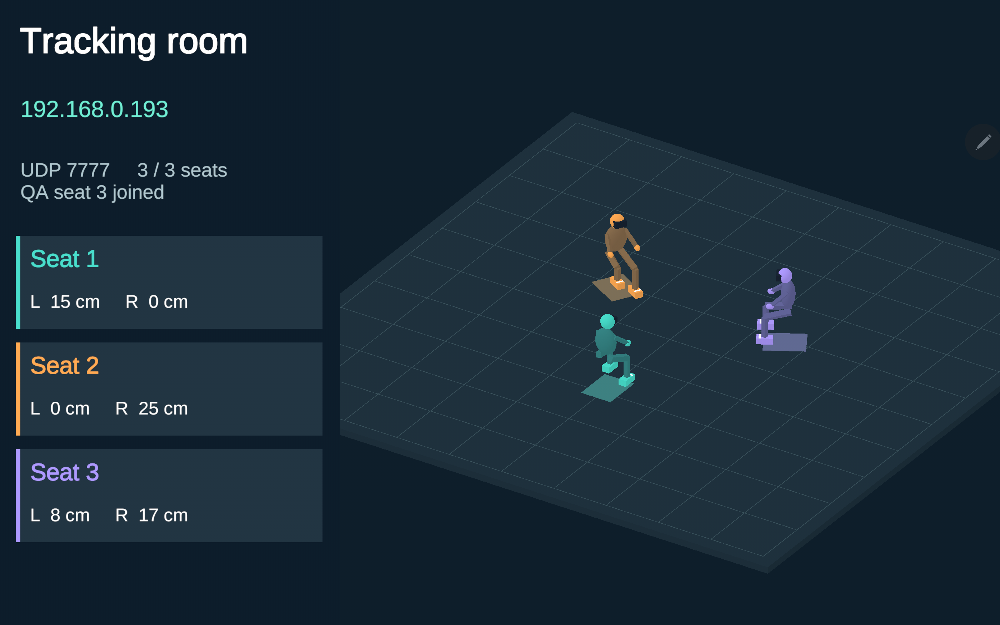
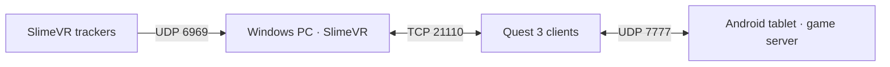

# VR Body Tracking for Quest 3

[][release]  [][slimevr]

Use six SlimeVR trackers on **one Quest 3** to see your knees and feet in a virtual mirror. Or give **three seated players** one tracker per shoe and let them see each other lift and lower their feet. The same standalone Quest app runs both modes. Unity developers can also import the tracking package into their own games.

**[Multiplayer smoke test](#multiplayer-smoke-test) · [Step over the cable](#step-over-the-cable) · [Run the demo](#run-the-demo) · [Import into Unity](#import-into-unity) · [Build from source](#build-from-source) · [Troubleshooting](#troubleshooting)**



*The game server running on a Galaxy Tab S9+ with three simulated headset clients. Seat 1 has its left foot raised 15 cm. Seat 2 has its right foot raised 25 cm.*

---

## Run the demo

| Where | Download | What it does |
| --- | --- | --- |
| Windows x64 PC | [Windows server ZIP][windows] | Receives all six trackers. Includes both SlimeVR launchers and Java. |
| Each Quest 3 | [Quest APK v0.1.0][quest] | Displays the solo mirror or joins a multiplayer seat. |
| Android tablet, for multiplayer | [Tablet APK v0.1.0][tablet] | Hosts the shared room and shows all three avatars. |

The standing and sitting controls below are in the [development build](#build-from-source). The linked **v0.1.0** APKs use **A** for calibration and show a seated multiplayer avatar.

Extract the entire Windows ZIP. When switching launchers, close the running SlimeVR GUI and server first. Connect the PC, trackers and headsets to the same LAN. Include the tablet for multiplayer. On Windows, run `ipconfig` and find the **IPv4 Address** of the Wi-Fi or Ethernet adapter on that network. This is the **Tracking PC** address the Quest asks for.

<details>
<summary><strong>Install the apps over USB</strong></summary>

Enable developer mode and USB debugging on the device, then accept the USB debugging prompt. From the download folder, use Android Platform Tools to list the connected devices. Replace each serial below with the one printed by `adb devices`.

```shell
adb devices
adb -s QUEST_SERIAL install -r BodyTracking-Quest.apk
adb -s TABLET_SERIAL install -r BodyTracking-Tablet.apk
```

On Quest, open **Body Tracking Quest** under **Unknown Sources**. On the tablet, open **Body Tracking Tablet** from the Android launcher.

</details>

### One player with six trackers

1. Run **`Start-Stock-Solo.cmd`** on the PC. Pair the sensors in SlimeVR and assign them to the **chest, hip, left and right thighs, and left and right lower legs**. [SlimeVR mounting guide][mounting]
2. Open the Quest app. Select **Six trackers / solo**, enter the PC's IPv4 address under **Tracking PC**, then choose **Start solo test**. The Quest now supplies the head pose to SlimeVR.
3. Complete the body measurements and mounting calibration in SlimeVR. With your shoes on the floor, face forward and press **X** in the room to reset yaw and set the first-person foot reference. Raise one knee and watch the knee and foot on that side move in the mirror. **A** switches your first-person avatar between standing and sitting. The mirror shows the six-tracker solve.


*The solo mirror in Unity, driven by the stock Windows server and six simulated sensors. The counter shows how many of the seven solved joints the headset is receiving.*

<a id="three-seated-players-with-two-trackers-each"></a>

### Multiplayer smoke test

Use the **v0.1.2 smoke APKs supplied to testers** for the cable mission. Two Quests and one tracker pair let both players see each other and test one player's feet. The [public v0.1.0 APKs][release] use seated avatars and **A** for calibration.

1. **Start the tablet.** Put all devices on the same LAN. Install `BodyTracking-Quest.apk` on each Quest and `BodyTracking-Tablet.apk` on the tablet. Open **Body Tracking Tablet** and note its IP.
2. **Start SlimeVR on Windows.** Close any other SlimeVR server and run `Start-Paired.cmd` from the extracted ZIP. Find the PC's LAN IPv4 address with `ipconfig`. [Windows server ZIP][windows]
3. **Join different seats.** Open **Unknown Sources → Body Tracking Quest**. Press **B** if already in the room. Choose **Paired feet / seat 1** on one Quest and **seat 2** on the other. Enter the PC's IP under **Tracking PC**. Leave **Tablet** on **Find on Wi-Fi** or enter its displayed IP.
4. **Check the soldiers.** Under **Soldier**, choose **Uniform** on one Quest and **Armored** on the other. Select **Enter multiplayer room** on both and take turns waving. Each player should see the other's hand move. The tablet should show both soldiers and label each outfit.
5. **Connect the shoes.** In SlimeVR's **Connect Trackers** wizard, enter your 2.4 GHz Wi-Fi details. Connect each powered-on main tracker to the PC by USB data cable, one at a time. Once online, strap one sensor to each shoe and set its exact **Tracker name**. Name extension sensors separately. [SlimeVR pairing instructions][pairing]

   | Seat | Left shoe | Right shoe |
   | --- | --- | --- |
   | 1 | `P1-L` | `P1-R` |
   | 2 | `P2-L` | `P2-R` |
   | 3 | `P3-L` | `P3-R` |

6. **Check foot lift.** Sit with both shoes flat, face forward and press **X on the left controller**. Wait for **Tracking both feet**. Look down, lift your left foot, then lower it. Both players should see only the left boot move. On the tablet, **L** for your seat should rise and return near **0 cm** while **R** stays near zero. Repeat on the right.


*Quest setup with seat 2 selected. In v0.1.1 and later, press **B** during play to change outfits. The headset remembers its choice across seats and restarts.*

| Controller | In settings | In the v0.1.1 and later rooms |
| --- | --- | --- |
| Left stick | Select a row or keypad key | Walk |
| Right stick | — | Turn |
| **A** (right controller) | Change the mode or soldier, press a key or enter the room | Toggle standing or sitting |
| **X** (left controller) | — | Reset yaw in solo mode or calibrate the shoes in paired mode |
| **B** | Back out of the keypad or close settings | Open settings |

Your avatar starts standing while you sit in your physical chair. Joystick movement keeps both boots at floor height until you lift a shoe.

### Step over the cable

1. Launch the **v0.1.2 Quest APK** in either tracking mode. For multiplayer, run the matching tablet APK. Look for the orange cable across the middle of the room.
2. Stay seated, rest both feet flat and press **X** to calibrate. Use the **left stick** to approach the cable. Within **75 cm**, lift each real foot until the headset counts it (about **8 cm** of tracked lift). Either foot can go first, and you can put it down before lifting the other.
3. Move across with the stick. Once your avatar is **15 cm past the cable**, your view turns **green for 1 second** if both feet counted, or **red for 5 seconds** if either was missed. Only the crossing player sees the tint.
4. To check the failure case, wait for the tint to clear and cross back with both feet flat. You can retry from either side. Walking around a plug gives no result.


<details>
<summary><strong>Network layout and ports</strong></summary>



Each Quest reads its own pair from the PC, then sends its avatar pose to the tablet. The tablet relays those poses and advertises the game on **UDP 47777**. A tablet hotspot works when its clients can reach the PC and one another.

</details>

---

## Import into Unity

In Unity 6.3, open **Window → Package Management → Package Manager → + → Install package from git URL** and paste the full line.

```text
https://github.com/blacktheon/VRBodyTracking.git?path=/Packages/com.blacktheon.body-tracking#v0.1.0
```

Look for **Blacktheon Body Tracking** by **blacktheon**. Add `BodyTrackingClient` to a GameObject. The package works with your own rig, avatars and networking. For an Android build, set **Internet Access** to **Require** in Player Settings. [Package API and examples][api]

| To read | Connect with | Use in your game |
| --- | --- | --- |
| Solved body joints | `BodyTrackingMode.SixTrackers`, a floor tracking origin and the headset transform | When `TryGetJoint(BodyJoint.LeftFoot, out var pose)` succeeds, `pose` is in Unity world space. |
| Seated foot lifts | `BodyTrackingMode.PairedFeet` and a seat number from 1 to 3 | `TryGetFootLift(true, out var metres)` reads the left shoe. Pass `false` for the right. |

<details>
<summary><strong>Example · drive two seated foot targets</strong></summary>

Save this as `SeatedFeet.cs`, attach it to a GameObject, and assign the two avatar foot targets in the Inspector. Enter the tracking PC's address and this player's seat. Start with both real feet flat.

```csharp
using Blacktheon.BodyTracking;
using UnityEngine;

[RequireComponent(typeof(BodyTrackingClient))]
public class SeatedFeet : MonoBehaviour
{
    public string pcAddress;
    [Range(1, 3)] public int seat = 1;
    public Transform leftFoot, rightFoot;

    BodyTrackingClient client;
    Vector3 leftRest, rightRest;

    void Start()
    {
        client = GetComponent<BodyTrackingClient>();
        leftRest = leftFoot.localPosition;
        rightRest = rightFoot.localPosition;
        client.Connect(pcAddress, seat, BodyTrackingMode.PairedFeet, null, null);
    }

    void LateUpdate()
    {
        client.TryGetFootLift(true, out float left);
        client.TryGetFootLift(false, out float right);
        leftFoot.localPosition = leftRest + Vector3.up * left;
        rightFoot.localPosition = rightRest + Vector3.up * right;
    }
}
```

An unavailable shoe returns `false` and zero metres, so this example puts that foot back at rest. Your UI can use the return value and `client.Status` to show signal loss. Call `client.Calibrate()` while seated to reset the floor reference.

</details>

## Build from source

Use **Unity 6000.3.19f1** with Android Build Support, including Unity's OpenJDK, SDK and NDK. The working Unity project is on **`develop`**. To reproduce the published version, use **`v0.1.0`** in the clone command. [Browse the Unity project][develop]

```powershell
git clone --branch develop https://github.com/blacktheon/VRBodyTracking.git
cd VRBodyTracking
.\Tools\Build-TestApps.ps1
```

The **v0.1.1 smoke APKs** already include both soldiers. Rebuilding that particular test requires the matching soldier-demo source and `BodyTrackingSoldiers.unitypackage`. In that checkout, choose **Assets → Import Package → Custom Package** before running the build script.

The script writes both APKs to `Builds/`. Use `-Role Quest` or `-Role Tablet` for a single build. The APKs start in `StepOverCable.unity` on Quest and `Tablet.unity` on the tablet. Open `Quest.unity` in the editor for the original free tracking room. [Demo scenes][scenes]

To rebuild the Windows companion, install Git and Node.js 22 or newer, then run `.\Tools\SlimeVR\Build-Windows.ps1`. The script builds and tests the stock and paired servers against SlimeVR v21.1.0 and writes the ZIP under `Builds/SlimeVR/`. [Windows build and protocol guide][server-source]

## Troubleshooting

| What you see | What to check |
| --- | --- |
| The headset is waiting for the PC | Check **Tracking PC** against `ipconfig`, confirm the correct launcher is running, and allow TCP 21110 on the PC's private LAN. |
| The tablet room is missing | Open the tablet app, enter its displayed IP on the Quest, and check that the Wi-Fi or hotspot permits traffic between clients on UDP 7777. |
| A seat is occupied or a shoe is unavailable | Give each headset its own seat. Check that each sensor is online and its custom name appears exactly once, including saved sensors currently unplugged. |
| A level shoe loses tracking when held still | Paired mode needs continuous linear acceleration. On SlimeVR ESP firmware v0.7.4, check `SEND_ACCELERATION=true` and `OPTIMIZE_UPDATES=false` in the firmware build for your board. [Firmware settings][firmware] |
| A foot stays raised after landing | Put both shoes flat and press **X** (**A** in v0.1.0). A still shoe produces the same acceleration at any height. The app estimates lift from the preceding movement, so a missed impulse can leave the estimate high. |

**Test coverage for v0.1.0.** Six simulated tracker devices drove the Windows servers. Three Unity clients exchanged independent foot lifts through a physical Galaxy Tab S9+, including a disconnect and rejoin. A clean Unity project installed the tagged Git package and passed its 24 package tests. Physical Quest 3 and shoe-mounted tracker validation is still pending.

[release]: https://github.com/blacktheon/VRBodyTracking/releases/tag/v0.1.0
[windows]: https://github.com/blacktheon/VRBodyTracking/releases/download/v0.1.0/VRBodyTracking-Windows-x64.zip
[quest]: https://github.com/blacktheon/VRBodyTracking/releases/download/v0.1.0/BodyTracking-Quest.apk
[tablet]: https://github.com/blacktheon/VRBodyTracking/releases/download/v0.1.0/BodyTracking-Tablet.apk
[api]: https://github.com/blacktheon/VRBodyTracking/blob/v0.1.0/Packages/com.blacktheon.body-tracking/README.md
[develop]: https://github.com/blacktheon/VRBodyTracking/tree/develop
[scenes]: https://github.com/blacktheon/VRBodyTracking/tree/v0.1.0/Assets/BodyTrackingDemo/Scenes
[server-source]: https://github.com/blacktheon/VRBodyTracking/blob/v0.1.0/Tools/SlimeVR/README.md
[slimevr]: https://github.com/SlimeVR/SlimeVR-Server/releases/tag/v21.1.0
[pairing]: https://docs.slimevr.dev/quick-setup.html#connecting-and-preparing-your-trackers
[mounting]: https://docs.slimevr.dev/server/putting-on-trackers.html
[firmware]: https://github.com/SlimeVR/SlimeVR-Tracker-ESP/blob/v0.7.4/src/debug.h
